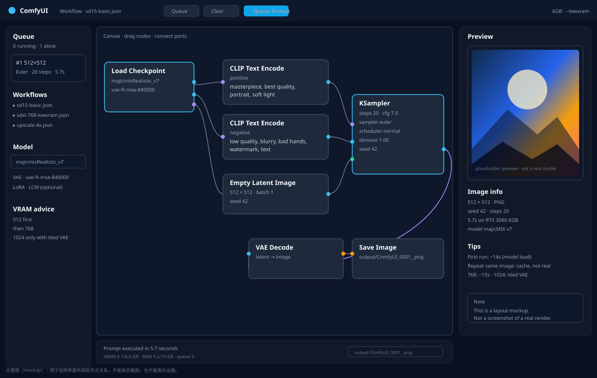
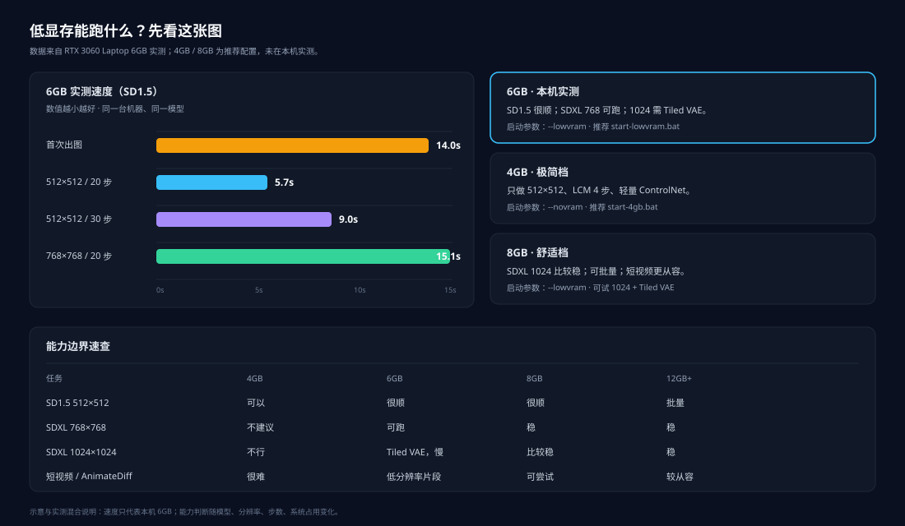
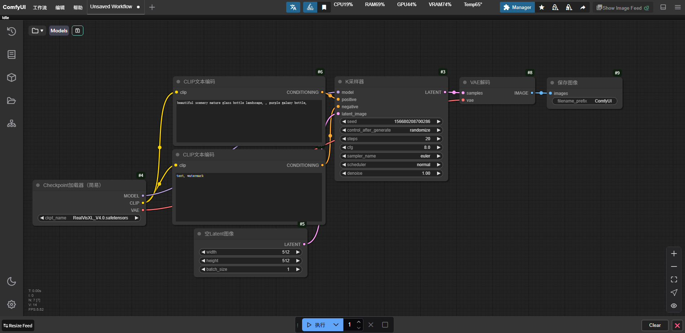
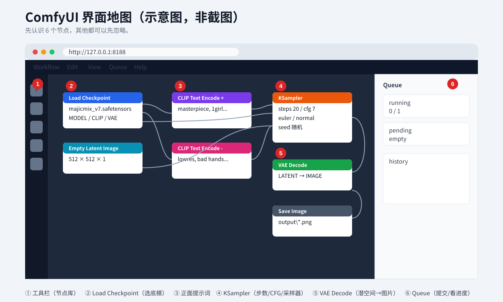
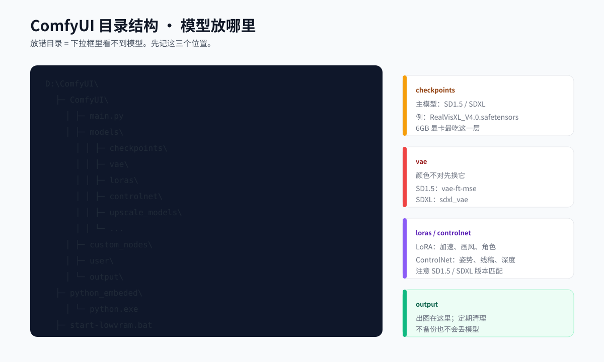

# ComfyUI Low-VRAM Deployment · ComfyUI 低显存部署

> **Language / 语言**: [中文](README.md) | English
> **Name / 名称**: ComfyUI Low-VRAM Deployment · ComfyUI 低显存部署

> **Runs on 4GB / 6GB / 8GB.** Written for people who are **touching ComfyUI for the first time**.
> The goal is not "install a piece of software", but to actually generate your first image on a machine with **modest VRAM**, and to know what to adjust next.
>
> - Tested on: Windows 11 + RTX 3060 Laptop **6GB** + 16GB RAM
> - ComfyUI version: **v0.42.1** (released 2026-10)
> - Document updated: 2026-11
> - Not using an AI? Reading this `README` is all you need.
> - Want an AI to install it for you? Hand the whole `AI-DEPLOY.en.md` to the AI.

<p>
  
  
  
  
  
</p>

## Project Introduction

This is not an "install package" that pastes a few commands at you and calls it done. It is a low-VRAM ComfyUI tutorial that goes **from checking your GPU to generating your first image**. Every step explains why it exists, what failure looks like, and what to adjust next.

**Who this is for**

- People touching ComfyUI for the first time, who get a headache as soon as they see nodes and error messages.
- People with only 4GB / 6GB / 8GB of VRAM who want to get their current machine running.
- People who want to download models from a checklist instead of stumbling through cloud drives, fake sites, and dead links.

**Who this is not for**

- People who already have a 24GB GPU and mainly run Flux / long videos; this document will deliberately cap your resolution.
- People who want an all-in-one package where they "never have to understand a single parameter"; you can install it, but problems become very hard to troubleshoot.

**What you get**

| Deliverable | Location |
|---|---|
| The full tutorial for humans | `README.en.md` (this file) |
| AI deployment protocol | `AI-DEPLOY.en.md` (Chinese: `AI-DEPLOY.md`) |
| Install / check / download scripts | `scripts/` |
| Two low-VRAM workflows | `workflows/` |
| Hardware, model, troubleshooting, and maintenance topics | `docs/` (Chinese) |
| Diagrams + real screenshots from this machine | `docs/images/` |

> English scope: this README and `AI-DEPLOY.en.md` are complete translations. The optional deep-dive files under `docs/` are currently in Chinese.

**Beginners, do these 3 things first**

1. Run `scripts/check-gpu.ps1` to confirm whether you are in the 4GB / 6GB / 8GB tier.
2. Install ComfyUI following Chapter 3, and download models following Chapter 4; do not install a pile of plugins first.
3. Launch following Chapters 5–6 and generate your first 512×512 image, then come back to Chapter 7 to tune the VRAM parameters.

---

## Preview

Look at the diagrams first, then at the real screenshots from this machine. The diagrams explain the layout; the real screenshots come from an RTX 3060 Laptop 6GB.





**Real interface on this machine** (ComfyUI + 6GB, `--lowvram`)



**Real output from this machine** (RealVisXL, 768×768, 20 steps, 6GB)


---

## Table of Contents

- [0. Bottom line: what your GPU can do](#0-bottom-line-what-your-gpu-can-do)
- [1. Three paths, pick one](#1-three-paths-pick-one)
- [2. Before installing: a 10-minute check](#2-before-installing-a-10-minute-check)
- [3. Step 1: Install ComfyUI](#3-step-1-install-comfyui)
- [4. Step 2: Download models](#4-step-2-download-models)
- [5. Step 3: Launch and open the web UI](#5-step-3-launch-and-open-the-web-ui)
- [6. Step 4: Generate your first image](#6-step-4-generate-your-first-image)
- [7. Low-VRAM tuning: the most valuable chapter](#7-low-vram-tuning-the-most-valuable-chapter)
- [8. Settings for common tasks](#8-settings-for-common-tasks)
- [9. Error first-aid table](#9-error-first-aid-table)
- [10. Where to download models: primary + backup channels](#10-where-to-download-models-primary--backup-channels)
- [11. Routine maintenance and upgrades](#11-routine-maintenance-and-upgrades)
- [12. FAQ](#12-faq)
- [Appendix A: Directory structure](#appendix-a-directory-structure)
- [Appendix B: Glossary](#appendix-b-glossary)
- [Appendix C: Model list](#appendix-c-model-list)

---

## 0. Bottom line: what your GPU can do

Many people only find out "it won't run" after they finish installing. Get your expectations straight first and you will save yourself three days of detours.

| VRAM | What it can do | What is not recommended |
|---|---|---|
| **4GB** | SD1.5 generation (512×512), LCM 4-step fast generation, lightweight ControlNet control, 4x upscaling | SDXL 1024, video, Flux |
| **6GB** | SD1.5 runs smoothly; SDXL 768×768 is workable, 1024 needs Tiled VAE and is slow; lightweight video (AnimateDiff / SVD at low resolution) | Long video, Wan 14B, HunyuanVideo, Flux dev |
| **8GB** | SDXL 1024 is fairly stable; SD1.5 in batches; short video with more headroom | Cinematic long shots, multi-person consistency |
| **12GB+** | SDXL batches, Flux fp8, lightweight video | 24GB-class models are still a struggle |

**Real 6GB speeds (RTX 3060 Laptop, measured)**

| Scenario | Time |
|---|---|
| First image (including loading a 2GB model) | about 14 seconds |
| 512×512 / 20 steps / Euler | about 7 seconds |
| 768×768 / 20 steps | about 15 seconds |
| 512×512 / 30 steps | about 9 seconds |
| SDXL 768×768 + upscale | 3–10 minutes |

> Clicking "Queue" repeatedly on the same image takes only 0.5 seconds — that is the cache, not real speed.

**One sentence**: 4–8GB can reliably do "a single image + lightweight control + short video clips", but cannot do "cinematic long shots" and "a character that stays consistent the whole way through". Do not burn time on models that will not run.

---

## 1. Three paths, pick one

### Route A: Do it yourself (recommended, most controllable)

Follow Chapters 2–6 of this document. You copy commands the whole way and do not need to know programming.

Suits: people willing to spend 1–2 hours and who want to tune things themselves later.

### Route B: Let an AI install it for me

1. Download the whole repository locally (or `git clone` it).
2. Open the AI you normally use (ChatGPT / Claude / DeepSeek / OpenCode all work).
3. Paste in **the entire contents of `AI-DEPLOY.en.md`**, then add:

   > Deploy ComfyUI on my computer following this document. Before each step, tell me what you are about to execute and wait for my confirmation; when you are done, you must run the acceptance commands and paste the raw output to me.

The AI will follow the steps, decision branches, and acceptance criteria in the document. All you have to do is click "allow" and watch the results.

Suits: people who do not want to touch the command line at all, but are willing to let an AI operate their computer.

### Route C: I just want to look, no install

Read Chapter 7 "Low-VRAM tuning" and Chapter 9 "Error first-aid table" first. Those two chapters are useful even if you never install anything.

---

## 2. Before installing: a 10-minute check

### 2.1 What you must have

| Item | Minimum | Recommended | How to check |
|---|---|---|---|
| OS | Windows 10 64-bit | Windows 11 | 设置 → 系统 → 关于 (Settings → System → About) |
| GPU | NVIDIA, 4GB VRAM | 6GB or more | 任务管理器 → 性能 → GPU (Task Manager → Performance → GPU) |
| Driver | Supports CUDA 12.x | A driver from 2025 or later | `nvidia-smi` |
| RAM | 16GB | 32GB | 任务管理器 → 性能 → 内存 (Task Manager → Performance → Memory) |
| Disk | 30GB free | 100GB free SSD | 资源管理器 (File Explorer) |
| Network | Can open web pages | Can reach ModelScope | Test in a browser |

> **AMD / Intel GPUs** can run it too, but this document only covers NVIDIA. For AMD cards, use `ComfyUI_windows_portable_amd.7z` and refer to the official docs; the low-VRAM parameter ideas are the same.

### 2.2 One-command check (recommended)

Open PowerShell in the repository root:

```powershell
powershell -ExecutionPolicy Bypass -File .\scripts\check-gpu.ps1
```

It outputs:

- GPU model, VRAM, driver version
- Amount of RAM
- Free space on the target drive
- Which model tier it recommends you use (minimal / standard / video)

### 2.3 Manual check (if you would rather not run a script)

```powershell
nvidia-smi
```

Look at three lines:

1. `Driver Version`: above 550 is reasonably safe.
2. `CUDA Version`: 12.x.
3. The `MiB` column: `XXXXMiB / 6144MiB`; the number after the slash is your VRAM.

If `nvidia-smi` is not recognized as an internal command:

- No NVIDIA driver installed → install one from [NVIDIA driver download](https://www.nvidia.cn/drivers/lookup/).
- You have integrated graphics / AMD → this document does not apply.

### 2.4 Three things you must do before installing

1. **Close software that eats VRAM**: games, browser video, CapCut (剪映), MuMu emulator, Wallpaper Engine.
2. **Increase virtual memory**: low-VRAM mode relies on offloading to RAM, and too little virtual memory will crash outright.
   - 设置 → 系统 → 关于 → 高级系统设置 → 性能设置 → 高级 → 虚拟内存 → 更改 (Settings → System → About → Advanced system settings → Performance Settings → Advanced → Virtual memory → Change)
   - Pick an SSD, set a custom size: initial `32768` MB, maximum `65536` MB
   - Restart after changing it
3. **No Chinese characters or spaces in the path**: `D:\ComfyUI` is fine; `D:\我的软件\ComfyUI 新` tends to cause problems.

---

## 3. Step 1: Install ComfyUI

### 3.1 Installation options

ComfyUI can be installed in three ways:

| Method | Who it suits | Pros | Cons |
|---|---|---|---|
| **Windows portable build (used in this guide)** | Beginners | Bundles Python + PyTorch, unzip and run | Large (about a 2GB archive) |
| Manual Python install | People who know Python | Flexible, saves space | Dependencies conflict easily |
| All-in-one package (秋叶 / Qiu Ye, etc.) | People who want it working out of the box | Comes with a launcher, many plugins | Many plugins make startup slow and troubleshooting hard |

**Beginners, use the portable build.** If something breaks it is the easiest to reinstall, and it will not pollute your system Python.

### 3.2 One-command install script

Open PowerShell in the repository root:

```powershell
powershell -ExecutionPolicy Bypass -File .\scripts\install-windows.ps1 -InstallDir "D:\ComfyUI"
```

The script does the following:

1. Checks Windows / the NVIDIA driver / disk space
2. Downloads the standalone 7-Zip extractor (only `7zr.exe`, no software is installed)
3. Downloads the ComfyUI portable build (about 2GB, resumable)
4. Extracts it to `D:\ComfyUI`
5. Generates the low-VRAM launch script `start-lowvram.bat`
6. Runs an install verification pass

> If the download is very slow, see the "backup channel for the install package" in [10. Where to download models](#10-where-to-download-models-primary--backup-channels).

### 3.3 Manual install (if the script fails)

1. Open [ComfyUI Releases](https://github.com/Comfy-Org/ComfyUI/releases).
2. Find the latest version and download **`ComfyUI_windows_portable_nvidia.7z`**.
   - Direct link (v0.42.1):
     `https://github.com/Comfy-Org/ComfyUI/releases/download/v0.42.1/ComfyUI_windows_portable_nvidia.7z`
3. Extract it to `D:\ComfyUI` with 7-Zip.
4. After extracting, it should look like this:

```text
D:\ComfyUI\
├─ ComfyUI\                 ← the application itself
├─ python_embeded\          ← bundled Python
├─ update\
├─ run_nvidia_gpu.bat       ← official launch script
└─ README.md
```

> If extraction produces an extra `ComfyUI_windows_portable` level, move its contents into `D:\ComfyUI`, or change the install path to that level.

### 3.4 Signs the install is complete

```powershell
Test-Path "D:\ComfyUI\ComfyUI\main.py"
Test-Path "D:\ComfyUI\python_embeded\python.exe"
```

Both must return `True` for the install to count as successful.

---

## 4. Step 2: Download models

### 4.1 First, understand: where models go

ComfyUI only recognizes fixed subdirectories under the `models` directory:

```text
D:\ComfyUI\ComfyUI\models\
├─ checkpoints\          ← main models (SD1.5 / SDXL), the most important
├─ vae\                  ← color decoder; some models include one
├─ loras\                ← speed-up, art style, characters
├─ controlnet\           ← image control (pose, line art, depth)
├─ upscale_models\       ← upscaling
├─ embeddings\           ← negative prompt embeddings
├─ facerestore_models\   ← face restoration
├─ rembg\                ← background removal
├─ inpaint\              ← object / watermark removal
└─ ...
```

Wrong directory = the model does not show up in ComfyUI. 90% of beginner "the model isn't showing" cases are this.

### 4.2 Recommended: download the "minimum usable pack" with the script first

```powershell
# List the catalog without downloading
python .\scripts\download-models.py --list

# 4GB GPU: download only the minimal pack (about 4GB)
python .\scripts\download-models.py --profile minimal --dest "D:\ComfyUI\ComfyUI\models"

# 6GB / 8GB: standard pack (about 23GB, includes SD1.5 + SDXL + control + upscaling)
python .\scripts\download-models.py --profile standard --dest "D:\ComfyUI\ComfyUI\models"

# Add this only if you want video (about 42GB, not recommended for a 4GB GPU)
python .\scripts\download-models.py --profile video --dest "D:\ComfyUI\ComfyUI\models"
```

Script features:

- Automatic source selection: ModelScope → HF mirror → CNB → official
- Resumable downloads: if it drops, rerun it and it will not start over
- Skips files that are already complete
- Automatically switches to the next source on failure
- Downloads models only, never any `.exe`

### 4.3 Download just one model

```powershell
python .\scripts\download-models.py --only realvisxl --dest "D:\ComfyUI\ComfyUI\models"
python .\scripts\download-models.py --only animagine --dest "D:\ComfyUI\ComfyUI\models"
```

Put the `id` from `models.json` after `--only`. Run `--list` first to see the ids.

### 4.4 Manual download (if the script fails)

Priority order:

1. **ModelScope (魔搭)**: direct connection inside China, fastest and most stable.
   - Open <https://modelscope.cn/models>
   - Search for the model name, go to "模型文件" (Model Files), and download the `.safetensors`.
2. **HF mirror**: <https://hf-mirror.com/>
   - Replace `huggingface.co` in the Hugging Face link with `hf-mirror.com`.
3. **CNB community mirror**: <https://cnb.cool/ai-models/zhanzhangtuijian/ComfyUI_models>
4. **Civitai**: <https://civitai.com/> (the most complete source for community models and LoRA; may require a VPN inside China)
5. **LiblibAI (哩布)**: <https://www.liblib.art/> (Chinese community, login required)

See [Chapter 10](#10-where-to-download-models-primary--backup-channels) for a detailed comparison.

### 4.5 How to confirm a download finished

```powershell
Get-ChildItem "D:\ComfyUI\ComfyUI\models\checkpoints" |
  Select-Object Name, @{n='GB';e={[math]::Round($_.Length/1GB,2)}}
```

You should normally see `.safetensors` files whose sizes match the catalog.

> A `.part` file means the download did not finish; a few-KB `.safetensors` usually means you downloaded a web page / pointer, so delete it and download again.

---

## 5. Step 3: Launch and open the web UI

### 5.1 Use the low-VRAM launch script

Double-click this file in the repository:

```text
D:\ComfyUI\start-lowvram.bat
```

Or from the command line:

```bat
cd /d D:\ComfyUI
python_embeded\python.exe -s ComfyUI\main.py --lowvram --use-pytorch-cross-attention --port 8188 --preview-method auto
```

If you see this line, it worked:

```text
To see the GUI go to: http://127.0.0.1:8188
```

Open <http://127.0.0.1:8188> in your browser.

### 5.2 What the launch parameters mean

| Parameter | Effect | When to use it |
|---|---|---|
| `--lowvram` | Splits the model into layers and swaps to RAM when VRAM runs short | **Must be on for 6GB** |
| `--novram` | Saves VRAM more aggressively, at the cost of speed | On 4GB, or when you hit OOM |
| `--use-pytorch-cross-attention` | Saves VRAM + speeds things up | Recommended on by default |
| `--port 8188` | Web UI port | Default is already 8188 |
| `--preview-method auto` | Shows a preview during sampling | Turn on if you want to watch progress |
| `--disable-all-custom-nodes` | Disables all plugins | First launch / isolating plugin problems |
| `--reserve-vram 0.5` | Reserves 0.5GB of VRAM for the system | When you hit OOM easily |

**Do not enable**: `--highvram` (it crashes low-VRAM machines outright).

### 5.3 The first launch is slow

- Clean install: 10–30 seconds.
- Lots of plugins installed: possibly 2–5 minutes.
- Slow startup does not mean it is broken; check whether the console ends with `To see the GUI...`.

> If you have dozens of plugins installed and startup spews `IMPORT FAILED`, launch with `--disable-all-custom-nodes` first, confirm basic generation works, then isolate the plugins one by one.

### 5.4 What the interface looks like



Beginners only need to know 6 nodes:

| Node | Purpose | Analogy |
|---|---|---|
| `Load Checkpoint` | Loads the main model | Choosing a brush |
| `CLIP Text Encode` (positive) | Write what you want | Ordering food |
| `CLIP Text Encode` (negative) | Write what you do not want | Dietary restrictions |
| `Empty Latent Image` | Sets the image size | Choosing a canvas |
| `KSampler` | Samples the image | Actually painting |
| `Save Image` | Saves it | Framing it |

---

## 6. Step 4: Generate your first image

### 6.1 Fastest path: drag in a workflow

1. Open `workflows/sd15-basic.json`.
2. Drag this file straight into the ComfyUI web page.
3. In the `Load Checkpoint` node, select the model you downloaded, for example `majicmixRealistic_v7.safetensors`.
4. Click **Queue** in the lower-right corner (or press `Ctrl + Enter`).
5. Wait 5–15 seconds and the image appears in the `Save Image` node.

> The first run loads the model, so it is normal for it to be slower. The second run with the same settings will be much faster.

### 6.2 How to fill in the parameters (SD1.5 beginner template)

| Parameter | Recommended value | Notes |
|---|---|---|
| Size | `512 × 512` | Most stable on 4–6GB; 768 works but is slower |
| Steps `steps` | `20` | 20–30 is enough; use 4–8 for LCM |
| CFG | `7` | Too high causes overexposure; use 5 for SDXL |
| Sampler `sampler` | `euler` | Most stable for beginners |
| Scheduler `scheduler` | `normal` | Use `karras` for finer detail |
| Batch `batch_size` | `1` | Do not use 2 on low VRAM |
| Seed `seed` | Random | Fix it if you want reproducibility |

**Positive prompt template**:

```text
masterpiece, best quality, highly detailed,
1girl, solo, upper body, looking at viewer,
soft lighting, cinematic, depth of field
```

**Negative prompt template**:

```text
lowres, bad anatomy, bad hands, text, watermark,
extra fingers, missing fingers, worst quality, jpeg artifacts
```

### 6.3 Success criteria for the first image

- An image appears on the right side of the web page, and it is not a black image or visual garbage.
- There is a file in the `output` directory:

```powershell
Get-ChildItem "D:\ComfyUI\ComfyUI\output" | Sort-Object LastWriteTime -Descending | Select-Object -First 5
```

- The console shows no red `Error` / `OOM`.

### 6.4 If you get a black image

1. Wrong VAE: switch to `vae-ft-mse-840000-ema-pruned.safetensors`, or change the VAE in `VAE Decode`.
2. Corrupted model download: the file size is wrong, download it again.
3. Steps too low / CFG too low: go back to 20 steps and CFG 7 first.
4. Mismatched LoRA in use: remove the LoRA first.

---

## 7. Low-VRAM tuning: the most valuable chapter

### 7.1 When VRAM runs short, downgrade in this order

```text
1. Lower the resolution: 1024 → 768 → 512
2. Lower the batch: 2 → 1
3. Enable Tiled VAE
4. Switch to a smaller model: SDXL → SD1.5
5. Switch to a quantized version: fp16 → fp8 → GGUF Q8 → Q4
6. Add --lowvram at launch
7. If that is still not enough, add --novram
8. Only then consider a new GPU / the cloud
```

### 7.2 Higher resolution is not always better

| Model | Native resolution | Recommendation for 6GB | Recommendation for 4GB |
|---|---|---|---|
| SD1.5 | 512×512 | 512–768 | 512 |
| SDXL | 1024×1024 | 768×768 (then upscale) | Not recommended |
| SD3.5 Medium | 1024 | 768 | Not recommended |

> The correct way to run SDXL on low VRAM: **generate at 768 → 4x upscale → then refine details**. Do not force 1024.

### 7.3 How to enable Tiled VAE

The native ComfyUI nodes include `VAE Decode (Tiled)`:

1. Right-click → Add Node → `latent` → `VAE Decode (Tiled)`.
2. Use it to replace the original `VAE Decode`.
3. Leave `tile_size` at the default 512 first; drop it to 256 if you hit OOM.

Effect: it decodes a large image in tiles, which greatly lowers peak VRAM. The cost is that it is a bit slower and the edges may have slight seams.

### 7.4 You need enough RAM too

Low-VRAM mode offloads model layers into **RAM**. 16GB of RAM is barely enough for SDXL; 32GB is noticeably more stable.

If you see:

```text
Allocation on device failed
or
OutOfMemoryError
```

Check Task Manager first:

- VRAM is full → lower the resolution / use `--novram`.
- RAM is full too → close the browser and games, or add virtual memory.
- Both are full → this model exceeds what the machine can do; switch to SD1.5.

### 7.5 Which launch script to use

| VRAM | Which script | Parameters |
|---|---|---|
| 4GB | `start-4gb.bat` | `--novram --use-pytorch-cross-attention --reserve-vram 0.3` |
| 6GB | `start-lowvram.bat` | `--lowvram --use-pytorch-cross-attention` |
| 8GB | `start-lowvram.bat` | Same as above; for SDXL 1024 you can try `--normalvram` |
| 12GB+ | Official `run_nvidia_gpu.bat` | Defaults are fine |

### 7.6 Speed: do not start by installing a pile of plugins

The mistake beginners make most often: install 50 plugins, startup takes 5 minutes, generation is barely faster, and errors pile up.

Suggested order:

1. Get it working with native nodes first.
2. Install ControlNet-related nodes only when you need image control.
3. Install Impact Pack only when you need face restoration.
4. Install upscaling nodes only when you need upscaling.
5. Install one at a time, and restart to verify after each one.

---

## 8. Settings for common tasks

### 8.1 Quickly testing composition (4-step generation)

- Base model: SD1.5 + `LCM-1.5-Lora`
- Size: 512×512
- Steps: 4–6
- CFG: 1.5–2
- Sampler: `lcm` or `euler`
- Purpose: quickly check the composition, then refine with 20 steps once you like it

### 8.2 Realistic portraits

- Base model: `RealVisXL_V4.0` (SDXL) or `majicmixRealistic_v7` (SD1.5)
- Size: 768×768 (6GB) / 512×768 (SD1.5)
- Steps: 25–30
- CFG: 5 (SDXL) / 7 (SD1.5)
- Sampler: `dpmpp_2m` + `karras`
- Bonus: FaceDetailer for face restoration

### 8.3 Anime / 2D

- Base model: `animagine-xl-4.0` or `MeinaMix_V11`
- Size: 768×768 (SDXL) / 512×512 (SD1.5)
- Steps: 25–30
- CFG: 7–7.5
- Add to the prompt: `masterpiece, best quality, anime style`

### 8.4 Pose / line-art control

- Base model: SD1.5
- ControlNet: `control_v11p_sd15_openpose_fp16` / `lineart_fp16`
- Weight: 0.8–1.0
- Size: 512×512
- When VRAM runs short: drop the ControlNet weight to 0.7 and the resolution to 512

### 8.5 Inpainting / watermark removal

- Base model: SD1.5 inpaint or a regular model
- Nodes: `Load Image` → `MaskEditor` → `VAE Encode (for Inpainting)` → `KSampler`
- Watermark removal: prefer `big-lama` / `fooocus_lama`, which do not need a diffusion model

### 8.6 Upscaling

- 4x-UltraSharp: realistic
- 4x-AnimeSharp: anime
- RealESRGAN_x4plus: general / old photos
- Low VRAM: upscale in tiles, `tile_size` 512 or 256

### 8.7 Video (6GB is just barely enough to play with)

| Approach | Model | Performance on 6GB |
|---|---|---|
| AnimateDiff | `mm_sd_v15_v2.ckpt` | 16 frames take about 3–5 minutes |
| SVD image-to-video | `svd_xt_1_1` | 25 frames at 1024 take about 5–8 minutes |
| Wan2.2 5B GGUF | `Wan2.2-TI2V-5B-Q8_0.gguf` | 3 seconds at 480p takes about 4–8 minutes |
| Frame interpolation | RIFE | Seconds |

> Video is the area with the biggest gap between "it runs" and "it is usable". On 6GB, only make 2–4 second test clips.

---

## 9. Error first-aid table

| Symptom | Most likely cause | What to do |
|---|---|---|
| The browser cannot open 8188 | The service did not start / the port is taken | Check the last line of the console; switch to `--port 8189` |
| `nvidia-smi` not found | No driver installed / not an NVIDIA card | Install the NVIDIA driver; for AMD cards switch to the AMD package |
| `torch.cuda.is_available()` is False | A CPU build got installed / the driver is too old | Reinstall the portable build; update the driver |
| `OutOfMemoryError` | Not enough VRAM | Lower the resolution, batch=1, Tiled VAE, `--novram` |
| The model dropdown is empty | Wrong directory / not refreshed | Put it in `models\checkpoints`; press `R` to refresh |
| The generated image is all black | VAE mismatch / corrupted model | Switch the VAE; download the model again |
| The generated image is visual garbage | The model download is incomplete / precision mismatch | Check the file size; switch to fp16 |
| Startup hangs on `IMPORT FAILED` | Incompatible plugin | Launch with `--disable-all-custom-nodes` |
| Startup takes 5 minutes | Too many plugins | Disable the broken ones; keep only what you need |
| `7z` not recognized as an internal command | 7-Zip is not installed | Use the script to fetch `7zr.exe` automatically, or install 7-Zip |
| The download stops at a few KB | You got a web page / LFS pointer | Download again with the script or ModelScope |
| Disk is full | Models are too large | Clean `output`, `.part` files, and unused models |
| The web page is very laggy | Browser preview + large images | Turn off the preview, lower the resolution |

For a more complete troubleshooting order, see [`docs/06-troubleshooting.md`](docs/06-troubleshooting.md).

---

## 10. Where to download models: primary + backup channels

### 10.1 Channel comparison (measured 2026-11)

| Channel | Speed in China | Login required | Best for | Stability | Rating |
|---|---|---|---|---|---|
| **ModelScope 魔搭** | Fast, usually 1–10 MB/s | No | Mainstream base models, ControlNet, VAE, Wan | High | ★★★★★ Primary |
| **CNB community mirror** | Fast, measured 1.5 MB/s | No | Bundled model packs, common ComfyUI models | Medium | ★★★★ Backup |
| **HF mirror hf-mirror** | Depends on the time of day, 0.1–2 MB/s | No | Foreign models, niche models | Medium | ★★★ Backup |
| **Hugging Face official** | Often unreachable from China | Some do | The newest models | High (from abroad) | ★★ Use only with a VPN |
| **Civitai** | Unstable in China | Yes | Community base models, LoRA, styles | High | ★★★★ Best for community models |
| **LiblibAI 哩布** | Fast | Yes | Models by Chinese creators, LoRA | High | ★★★★ Chinese community |
| **Baidu Netdisk / Quark** | Depends on membership | Yes | All-in-one packs other people built | Low (may contain malware) | ★ Last resort |

### 10.2 Recommended download order

```text
Try ModelScope first
  ↓ not there
Try the CNB community mirror
  ↓ not there
Try hf-mirror
  ↓ still nothing
Civitai / LiblibAI (community models)
  ↓ none of them
Cloud drive (only from people you trust; verify size and hash after downloading)
```

### 10.3 Direct links for common models

> Repository names can be turned straight into links: `https://huggingface.co/<repo-name>`; inside China, replace the domain with `https://hf-mirror.com/<repo-name>`.

| Model | Purpose | Size | Repository / download page |
|---|---|---|---|
| SD1.5 official | The most basic base model | 4.3GB | `stable-diffusion-v1-5/stable-diffusion-v1-5` |
| SDXL official | SDXL base | 6.9GB | `stabilityai/stable-diffusion-xl-base-1.0` |
| majicMIX Realistic v7 | SD1.5 realistic portraits | 2.0GB | `digiplay/majicMIX_realistic_v7` |
| MeinaMix V11 | SD1.5 anime | 2.0GB | `Meina/MeinaMix_V11` |
| DreamShaper 8 | SD1.5 general | 2.0GB | `Lykon/dreamshaper-8` |
| Counterfeit V3.0 | SD1.5 anime | 4.0GB | `gsdf/Counterfeit-V3.0` |
| RealVisXL V4.0 | SDXL realistic portraits | 6.5GB | `SG161222/RealVisXL_V4.0` |
| Juggernaut XI | SDXL realistic landscapes | 6.6GB | `RunDiffusion/Juggernaut-XI-v11` |
| Animagine XL 4.0 | SDXL anime | 6.9GB | `cagliostrolab/animagine-xl-4.0` |
| ControlNet v1.1 | SD1.5 image control | 0.7–1.4GB | `lllyasviel/ControlNet-v1-1` |
| ControlNet fp16 | SD1.5 image control, VRAM-saving | 0.7GB | `comfyanonymous/ControlNet-v1-1_fp16_safetensors` |
| ControlNet Union SDXL | SDXL universal image control | 2.3GB | `xinsir/controlnet-union-sdxl-1.0` |
| LCM LoRA SD1.5 | 4-step speed-up | 0.13GB | `latent-consistency/lcm-lora-sdv1-5` |
| LCM LoRA SDXL | SDXL speed-up | 0.37GB | `latent-consistency/lcm-lora-sdxl` |
| SVD XT 1.1 | Image-to-video | 4.5GB | `stabilityai/stable-video-diffusion-img2vid-xt-1-1` |
| AnimateDiff | SD1.5 animation | 1.7GB | `guoyww/animatediff` |
| RMBG-1.4 | Background removal | 0.16GB | `briaai/RMBG-1.4` |
| CodeFormer | Face restoration | 0.35GB | `sczhou/CodeFormer` |
| GFPGAN v1.4 | Face restoration | 0.32GB | `TencentARC/GFPGAN` |
| IP-Adapter | Reference image / face consistency | 0.1GB | `h94/IP-Adapter` |
| Depth Anything V2 | Depth maps | 0.6GB | `depth-anything/Depth-Anything-V2-Large` |
| SAM vit-base | Click-to-segment | 0.35GB | `facebook/sam-vit-base` |
| Wan2.2 5B GGUF | Low-VRAM video | 5.0GB | `QuantStack/Wan2.2-TI2V-5B-GGUF` |

> For exact filenames, refer to each repository's "Files and versions" page. Check the size before downloading, and do not end up with a README or `.gitattributes`.

### 10.4 Backup channel for the install package

Primary channel for the ComfyUI portable build:

- GitHub Releases: <https://github.com/Comfy-Org/ComfyUI/releases>
- Direct link (v0.42.1):
  `https://github.com/Comfy-Org/ComfyUI/releases/download/v0.42.1/ComfyUI_windows_portable_nvidia.7z`

If GitHub will not download:

1. Use a `ghproxy`-style acceleration prefix (verify for yourself that it works).
2. Ask a friend who has access to download it and send it to you via a cloud drive, and **verify the file size and SHA256**.
3. Use a Chinese all-in-one package (秋叶 / Qiu Ye, etc.) as a stopgap, but be aware of the many plugins and slow startup.

> Do not download "ComfyUI 一键包.exe" from unfamiliar cloud drives. Download only `.7z`, extract it yourself, and run it; `.exe` installers carry high risk.

---

## 11. Routine maintenance and upgrades

### 11.1 Upgrading ComfyUI

The portable build ships with an `update` directory:

```bat
cd /d D:\ComfyUI
update\update_comfyui.bat
```

Before upgrading, it is advisable to:

1. Back up `ComfyUI\custom_nodes` and `ComfyUI\user`.
2. Note the current version (the first line of the startup log).
3. If plugins error out after the upgrade, verify basic functionality with `--disable-all-custom-nodes` first.

### 11.2 What to back up

| Content | Back up? | Notes |
|---|---|---|
| `models` | Depends on size | Large, but re-downloading takes a lot of time; at least back up the 3–5 you use most |
| `custom_nodes` | Yes | Plugin configuration and code |
| `user` | Yes | Workflows, settings, presets |
| `output` | Depends on need | Your work |
| `python_embeded` | No | Can be reinstalled |
| `__pycache__` | No | Cache |

### 11.3 Cleaning up disk space

```powershell
# See what takes up the most space
Get-ChildItem "D:\ComfyUI\ComfyUI\models" -Recurse -File |
  Sort-Object Length -Descending |
  Select-Object -First 20 FullName, @{n='GB';e={[math]::Round($_.Length/1GB,2)}}

# Delete unfinished .part files
Get-ChildItem "D:\ComfyUI\ComfyUI\models" -Recurse -Filter *.part | Remove-Item
```

### 11.4 Stay reproducible

Every time you install something new, write down one line:

```text
date / what was installed / version / where it came from / verification result
```

That way you can roll back quickly when something breaks.

---

## 12. FAQ

**Q: I only have integrated graphics. Can it run?**
A: CPU mode works, but a single image takes anywhere from a few minutes to tens of minutes. It is better to go straight to the cloud (for example 智算云扉, RunPod, Colab).

**Q: Can 6GB run SDXL?**
A: Yes, but 768×768 + Tiled VAE + `--lowvram` is recommended. 1024 easily runs out of memory.

**Q: Why does someone else generate an image in 10 seconds while I need 2 minutes?**
A: The GPU, resolution, step count, model size, and whether it is the first load are all different. Compare at the same resolution and step count first.

**Q: Do I have to install ControlNet?**
A: No. Play with text-to-image first, and install it when you need pose / line-art control.

**Q: Can models be mixed and matched?**
A: SD1.5 ControlNet/LoRA cannot be used directly with SDXL; it will error out or produce very poor results.

**Q: Which is better, an all-in-one package or the portable build?**
A: Beginners should use the portable build first: it is clean and easy to troubleshoot. All-in-one packages suit "I just want to play right now", but they come with many plugin problems.

**Q: Do I need a VPN?**
A: ModelScope / CNB / LiblibAI do not require one. Civitai / Hugging Face official may.

**Q: Can I use the output commercially?**
A: It depends on the model license. SD1.5 is relatively permissive, SDXL has OpenRAIL++ restrictions, and community models differ from one another. Check each model card before commercial use.

---

## Appendix A: Directory structure



```text
D:\ComfyUI\
├─ ComfyUI\
│  ├─ main.py
│  ├─ models\
│  │  ├─ checkpoints\
│  │  ├─ vae\
│  │  ├─ loras\
│  │  ├─ controlnet\
│  │  ├─ upscale_models\
│  │  └─ ...
│  ├─ custom_nodes\
│  ├─ user\
│  │  └─ default\
│  └─ output\
├─ python_embeded\
│  └─ python.exe
├─ update\
├─ start-lowvram.bat        ← generated by this guide
├─ start-4gb.bat            ← generated by this guide
└─ run_nvidia_gpu.bat       ← official
```

## Appendix B: Glossary

| Term | Plain-language explanation |
|---|---|
| Checkpoint / base model | The main model, which determines art style and quality |
| VAE | Decodes the latent space into an image; if the colors are wrong, swap this first |
| LoRA | A small patch that adds art style, characters, or speed |
| ControlNet | An image-control plugin that generates according to pose / line art / depth |
| Sampler | Decides "how to draw" |
| Steps | How many steps to draw; more is more detailed but slower |
| CFG | How closely it follows the prompt; too high makes it stiff |
| Seed | The random seed; fix it for reproducibility |
| Latent | The latent space, the model's internal representation of an image |
| Tiled VAE | Tiled decoding, saves VRAM |
| OOM | Out Of Memory, not enough VRAM/RAM |
| GGUF | A quantized model format; saves VRAM but is slower |

## Appendix C: Model list

See [`scripts/models.json`](scripts/models.json) for the complete list and download sources.

Quick memory aid:

- **4GB**: SD1.5 + LCM + 4x-UltraSharp + one ControlNet
- **6GB**: the above + RealVisXL or Animagine (for 768)
- **8GB**: the above + SDXL 1024 + lightweight video

---

## Finally: the limits of this document

- The measured data comes from one 6GB laptop; **different GPUs/drivers will differ**.
- Model links may go dead; when they do, find the model with the same name using the "download order" in Chapter 10.
- This document provides nothing related to cracking, piracy, or bypassing payment.
- Check the model license yourself before commercial use.

If this document helped you get your first image working, feel free to open an Issue and add your measured data from your machine.
