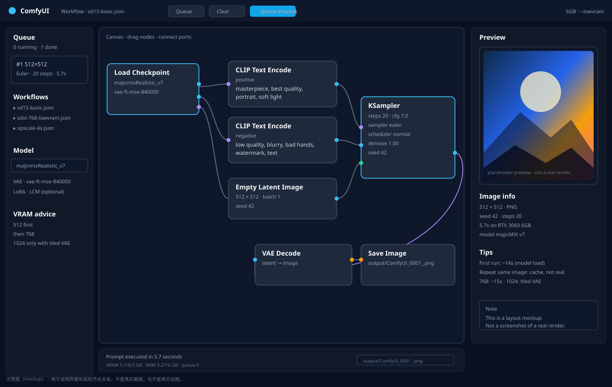
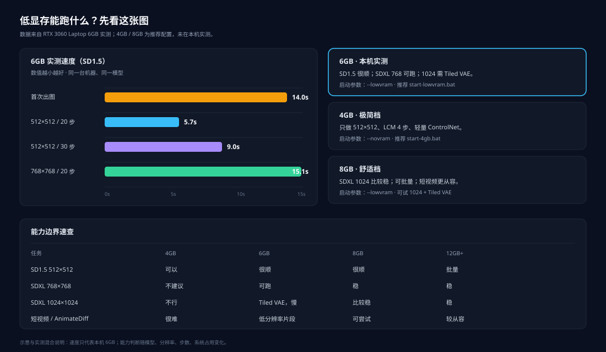
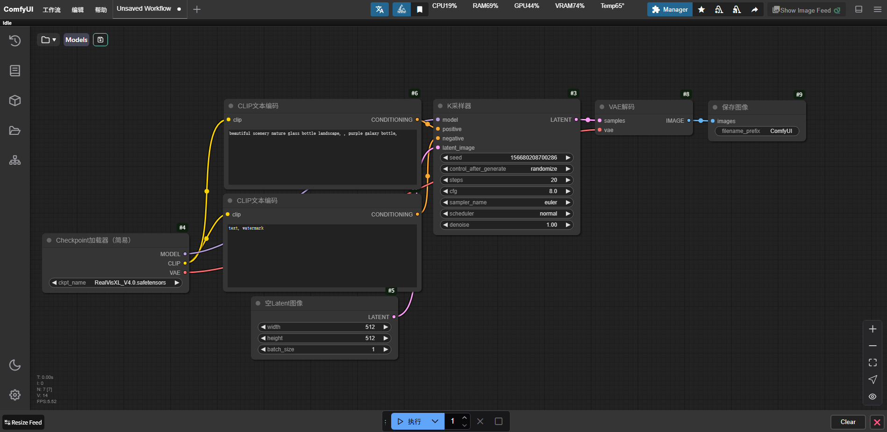
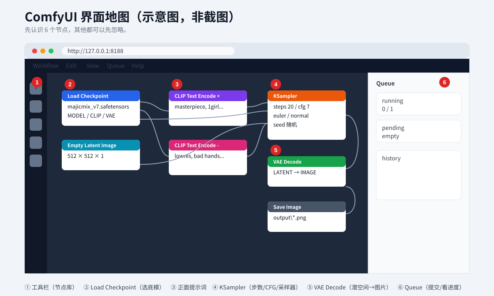
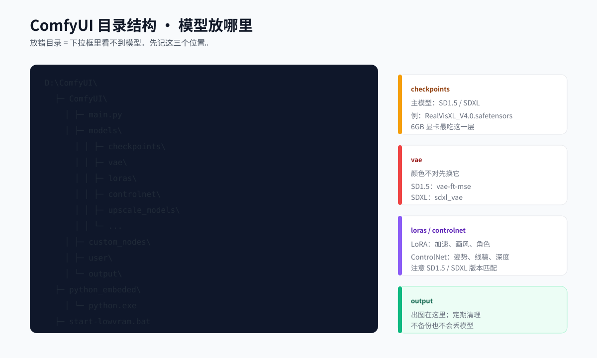

# ComfyUI 低显存部署 · ComfyUI Low-VRAM Deployment

> **Language / 语言**: 中文 | [English](README.en.md)
> **名称 / Name**: ComfyUI 低显存部署 · ComfyUI Low-VRAM Deployment

> **4GB / 6GB / 8GB 也能跑。** 写给**第一次接触 ComfyUI**的人。
> 目标不是“装一个软件”，而是让你在**显存不大**的电脑上，真的生成第一张图，并且知道下一步该调什么。
>
> - 实测环境：Windows 11 + RTX 3060 Laptop **6GB** + 16GB 内存
> - ComfyUI 版本：**v0.42.1**（2026-10 发布）
> - 文档更新：2026-11
> - 不会用 AI？只看这份 `README.md` 就够了。
> - 想让 AI 帮你装？把 `AI-DEPLOY.md` 整个丢给 AI。

<p>
  
  
  
  
  
</p>

## 项目简介

这不是“把命令贴给你就完事”的安装包，而是一份**从检查显卡到生成第一张图**的低显存 ComfyUI 教程。每一步都写了为什么、失败长什么样、下一步怎么调。

**适合谁**

- 第一次接触 ComfyUI，看到节点和报错就头大的人。
- 显卡只有 4GB / 6GB / 8GB，想让现有电脑先跑起来的人。
- 想按清单下模型，不想在网盘、假站、失效链接里踩坑的人。

**不适合谁**

- 已经有 24GB 显卡、主要跑 Flux / 长视频的人；这份文档会主动限制你的分辨率。
- 想要“完全不用理解参数”的整合包的人；能装，但出问题很难排查。

**你会得到什么**

| 产物 | 位置 |
|---|---|
| 人看的完整教程 | `README.md`（本文） |
| AI 部署协议 | `AI-DEPLOY.md` |
| 安装/检查/下载脚本 | `scripts/` |
| 两个低显存工作流 | `workflows/` |
| 硬件、模型、排错、维护专题 | `docs/` |
| 示意图 + 本机真实截图 | `docs/images/` |

**新手先做这 3 步**

1. 跑 `scripts/check-gpu.ps1`，确认自己属于 4GB / 6GB / 8GB 哪一档。
2. 按第 3 章装 ComfyUI，按第 4 章下模型；不要先装一堆插件。
3. 按第 5–6 章启动并生成第一张 512×512 图，再回第 7 章调显存参数。

---

## 效果预览

先看示意图，再看本机真实运行截图。示意图用来说明布局，真实截图来自 RTX 3060 Laptop 6GB。





**本机真实界面**（ComfyUI + 6GB，`--lowvram`）



**本机真实出图**（RealVisXL，768×768，20 步，6GB）


---

## 目录

- [0. 先说结论：你的显卡能做什么](#0-先说结论你的显卡能做什么)
- [1. 三条路线，选一条](#1-三条路线选一条)
- [2. 装之前：10 分钟检查](#2-装之前10-分钟检查)
- [3. 第一步：安装 ComfyUI](#3-第一步安装-comfyui)
- [4. 第二步：下载模型](#4-第二步下载模型)
- [5. 第三步：启动并打开网页](#5-第三步启动并打开网页)
- [6. 第四步：生成第一张图](#6-第四步生成第一张图)
- [7. 低显存调参：这一章最值钱](#7-低显存调参这一章最值钱)
- [8. 常用任务怎么配](#8-常用任务怎么配)
- [9. 报错急救表](#9-报错急救表)
- [10. 模型从哪下：主通道 + 备用通道](#10-模型从哪下主通道--备用通道)
- [11. 日常维护与升级](#11-日常维护与升级)
- [12. 常见问题](#12-常见问题)
- [附录 A：目录结构](#附录-a目录结构)
- [附录 B：术语表](#附录-b术语表)
- [附录 C：模型清单](#附录-c模型清单)

---

## 0. 先说结论：你的显卡能做什么

很多人装完才发现“跑不动”。先把预期摆正，少走三天弯路。

| 显存 | 能做什么 | 不建议做什么 |
|---|---|---|
| **4GB** | SD1.5 出图（512×512）、LCM 4 步快速出图、ControlNet 轻量控图、4 倍放大 | SDXL 1024、视频、Flux |
| **6GB** | SD1.5 很顺；SDXL 768×768 可跑，1024 要 Tiled VAE 且慢；轻量视频（AnimateDiff / SVD 低分辨率） | 长视频、Wan 14B、HunyuanVideo、Flux dev |
| **8GB** | SDXL 1024 比较稳；SD1.5 批量；短视频更从容 | 电影级长镜头、多人一致性 |
| **12GB+** | SDXL 批量、Flux fp8、轻量视频 | 24GB 级别的模型仍然吃力 |

**6GB 的真实速度（RTX 3060 Laptop，实测）**

| 场景 | 耗时 |
|---|---|
| 首次出图（含加载 2GB 模型） | 约 14 秒 |
| 512×512 / 20 步 / Euler | 约 7 秒 |
| 768×768 / 20 步 | 约 15 秒 |
| 512×512 / 30 步 | 约 9 秒 |
| SDXL 768×768 + 放大 | 3–10 分钟 |

> 同一张图重复点“Queue”只要 0.5 秒，那是缓存，不是真实速度。

**一句话**：4–8GB 能稳定做“单张图 + 轻量控图 + 短视频片段”，做不了“电影级长镜头”和“角色全程一致”。别在跑不动的模型上烧时间。

---

## 1. 三条路线，选一条

### 路线 A：我自己动手（推荐，最可控）

照着本文第 2–6 章做。全程复制命令，不需要懂编程。

适合：愿意花 1–2 小时、想以后自己调的人。

### 路线 B：让 AI 帮我装

1. 把整个仓库下载到本地（或 `git clone`）。
2. 打开你常用的 AI（ChatGPT / Claude / DeepSeek / OpenCode 都行）。
3. 把 **`AI-DEPLOY.md` 的全部内容**粘贴进去，再说一句：

   > 按这份文档在我电脑上部署 ComfyUI。每做一步先告诉我你要执行什么，得到我确认后再执行；装完必须跑验收命令并把原始输出贴给我。

AI 会按文档里的步骤、判断分支和验收标准执行。你只需要点“允许”和看结果。

适合：完全不想碰命令行，但愿意让 AI 操作电脑的人。

### 路线 C：我只想看看，不装

先读第 7 章“低显存调参”和第 9 章“报错急救表”。这两章即使不装也有用。

---

## 2. 装之前：10 分钟检查

### 2.1 你必须有的东西

| 项目 | 最低 | 推荐 | 怎么确认 |
|---|---|---|---|
| 系统 | Windows 10 64 位 | Windows 11 | 设置 → 系统 → 关于 |
| 显卡 | NVIDIA，4GB 显存 | 6GB 以上 | 任务管理器 → 性能 → GPU |
| 驱动 | 支持 CUDA 12.x | 2025 年后的驱动 | `nvidia-smi` |
| 内存 | 16GB | 32GB | 任务管理器 → 性能 → 内存 |
| 硬盘 | 30GB 空闲 | 100GB 空闲 SSD | 资源管理器 |
| 网络 | 能打开网页 | 能访问 ModelScope | 浏览器测试 |

> **AMD / Intel 显卡**也能跑，但本文只写 NVIDIA。A 卡请用 `ComfyUI_windows_portable_amd.7z`，并参考官方文档；低显存参数思路一样。

### 2.2 一键检查（推荐）

在仓库根目录打开 PowerShell：

```powershell
powershell -ExecutionPolicy Bypass -File .\scripts\check-gpu.ps1
```

它会输出：

- 显卡型号、显存、驱动版本
- 内存大小
- 目标盘剩余空间
- 推荐你走哪个模型档位（minimal / standard / video）

### 2.3 手动检查（不想跑脚本）

```powershell
nvidia-smi
```

看三行：

1. `Driver Version`：大于 550 比较稳。
2. `CUDA Version`：12.x。
3. `MiB` 那一列：`XXXXMiB / 6144MiB`，斜杠后面就是显存。

如果 `nvidia-smi` 不是内部命令：

- 没装 NVIDIA 驱动 → 去 [NVIDIA 驱动下载](https://www.nvidia.cn/drivers/lookup/) 装。
- 装的是核显/AMD → 本文不适用。

### 2.4 装之前必须做的三件事

1. **关掉吃显存的软件**：游戏、浏览器视频、剪映、MuMu 模拟器、Wallpaper Engine。
2. **把虚拟内存调大**：低显存靠内存卸载，虚拟内存太小会直接崩。
   - 设置 → 系统 → 关于 → 高级系统设置 → 性能设置 → 高级 → 虚拟内存 → 更改
   - 选一个 SSD 盘，自定义大小：初始 `32768` MB，最大 `65536` MB
   - 改完重启
3. **路径不要有中文和空格**：`D:\ComfyUI` 可以，`D:\我的软件\ComfyUI 新` 容易出问题。

---

## 3. 第一步：安装 ComfyUI

### 3.1 安装方式说明

ComfyUI 有三种装法：

| 方式 | 适合谁 | 优点 | 缺点 |
|---|---|---|---|
| **Windows 便携版（本文用这个）** | 新手 | 自带 Python + PyTorch，解压即用 | 体积大（约 2GB 压缩包） |
| 手动 Python 安装 | 会 Python 的人 | 灵活、省空间 | 依赖容易冲突 |
| 整合包（秋叶等） | 想开箱即用的人 | 带启动器、插件多 | 插件多导致启动慢、难排查 |

**新手请用便携版。** 出问题最容易重装，不会污染系统 Python。

### 3.2 一键安装脚本

在仓库根目录打开 PowerShell：

```powershell
powershell -ExecutionPolicy Bypass -File .\scripts\install-windows.ps1 -InstallDir "D:\ComfyUI"
```

脚本会做这些事：

1. 检查 Windows / NVIDIA 驱动 / 磁盘空间
2. 下载 7-Zip 独立解压器（只下 `7zr.exe`，不装软件）
3. 下载 ComfyUI 便携版（约 2GB，支持断点续传）
4. 解压到 `D:\ComfyUI`
5. 生成低显存启动脚本 `start-lowvram.bat`
6. 跑一次安装校验

> 如果下载很慢，见 [10. 模型从哪下](#10-模型从哪下主通道--备用通道) 的“安装包备用通道”。

### 3.3 手动安装（脚本失败时）

1. 打开 [ComfyUI Releases](https://github.com/Comfy-Org/ComfyUI/releases)。
2. 找到最新版，下载 **`ComfyUI_windows_portable_nvidia.7z`**。
   - 直链（v0.42.1）：
     `https://github.com/Comfy-Org/ComfyUI/releases/download/v0.42.1/ComfyUI_windows_portable_nvidia.7z`
3. 用 7-Zip 解压到 `D:\ComfyUI`。
4. 解压后应该是：

```text
D:\ComfyUI\
├─ ComfyUI\                 ← 程序本体
├─ python_embeded\          ← 自带 Python
├─ update\
├─ run_nvidia_gpu.bat       ← 官方启动脚本
└─ README.md
```

> 如果解压出来多了一层 `ComfyUI_windows_portable`，把里面的东西移到 `D:\ComfyUI`，或者把安装路径改成那一层。

### 3.4 安装完成的标志

```powershell
Test-Path "D:\ComfyUI\ComfyUI\main.py"
Test-Path "D:\ComfyUI\python_embeded\python.exe"
```

两个都返回 `True` 才算装好。

---

## 4. 第二步：下载模型

### 4.1 先理解：模型放哪里

ComfyUI 只认 `models` 目录下的固定子目录：

```text
D:\ComfyUI\ComfyUI\models\
├─ checkpoints\          ← 主模型（SD1.5 / SDXL），最重要
├─ vae\                  ← 色彩解码器，有些模型自带
├─ loras\                ← 加速、画风、角色
├─ controlnet\           ← 控图（姿势、线稿、深度）
├─ upscale_models\       ← 放大
├─ embeddings\           ← 负面词嵌入
├─ facerestore_models\   ← 修脸
├─ rembg\                ← 抠图
├─ inpaint\              ← 去物体 / 去水印
└─ ...
```

放错目录 = ComfyUI 里看不到模型。新手 90% 的“模型不显示”都是这个原因。

### 4.2 推荐：先用脚本下“最小可用包”

```powershell
# 先看清单，不下载
python .\scripts\download-models.py --list

# 4GB 显卡：只下最小包（约 4GB）
python .\scripts\download-models.py --profile minimal --dest "D:\ComfyUI\ComfyUI\models"

# 6GB / 8GB：标准包（约 23GB，含 SD1.5 + SDXL + 控制 + 放大）
python .\scripts\download-models.py --profile standard --dest "D:\ComfyUI\ComfyUI\models"

# 想玩视频再加（约 42GB，不建议 4GB 显卡）
python .\scripts\download-models.py --profile video --dest "D:\ComfyUI\ComfyUI\models"
```

脚本特性：

- 自动选源：ModelScope → HF 镜像 → CNB → 官方
- 断点续传：断了重跑，不会从头下
- 跳过已下完的文件
- 失败自动换下一个源
- 只下模型，不下任何 `.exe`

### 4.3 只下某一个模型

```powershell
python .\scripts\download-models.py --only realvisxl --dest "D:\ComfyUI\ComfyUI\models"
python .\scripts\download-models.py --only animagine --dest "D:\ComfyUI\ComfyUI\models"
```

`--only` 后面填 `models.json` 里的 `id`。先 `--list` 看 id。

### 4.4 手动下载（脚本失败时）

优先顺序：

1. **ModelScope（魔搭）**：国内直连，最快最稳。
   - 打开 <https://modelscope.cn/models>
   - 搜模型名，进“模型文件”，下 `.safetensors`。
2. **HF 镜像**：<https://hf-mirror.com/>
   - 把 Hugging Face 链接里的 `huggingface.co` 换成 `hf-mirror.com`。
3. **CNB 社区镜像**：<https://cnb.cool/ai-models/zhanzhangtuijian/ComfyUI_models>
4. **Civitai**：<https://civitai.com/>（社区模型、LoRA 最全，国内可能需要网络工具）
5. **LiblibAI**：<https://www.liblib.art/>（国内社区，需登录）

详细对比见 [第 10 章](#10-模型从哪下主通道--备用通道)。

### 4.5 下载完怎么确认

```powershell
Get-ChildItem "D:\ComfyUI\ComfyUI\models\checkpoints" |
  Select-Object Name, @{n='GB';e={[math]::Round($_.Length/1GB,2)}}
```

正常应该看到 `.safetensors` 文件，大小和清单对得上。

> 看到 `.part` 是没下完；看到几 KB 的 `.safetensors` 多半是下到了网页/指针，删掉重下。

---

## 5. 第三步：启动并打开网页

### 5.1 用低显存启动脚本

双击仓库里的：

```text
D:\ComfyUI\start-lowvram.bat
```

或者命令行：

```bat
cd /d D:\ComfyUI
python_embeded\python.exe -s ComfyUI\main.py --lowvram --use-pytorch-cross-attention --port 8188 --preview-method auto
```

看到这一行就成功了：

```text
To see the GUI go to: http://127.0.0.1:8188
```

浏览器打开 <http://127.0.0.1:8188>。

### 5.2 启动参数是什么意思

| 参数 | 作用 | 什么时候用 |
|---|---|---|
| `--lowvram` | 把模型分层，显存不够时自动换到内存 | **6GB 必开** |
| `--novram` | 更激进地省显存，速度更慢 | 4GB 或 OOM 时 |
| `--use-pytorch-cross-attention` | 省显存 + 提速 | 推荐默认开 |
| `--port 8188` | 网页端口 | 默认就是 8188 |
| `--preview-method auto` | 采样时显示预览 | 想看进度就开 |
| `--disable-all-custom-nodes` | 禁用所有插件 | 第一次启动 / 排查插件问题 |
| `--reserve-vram 0.5` | 给系统留 0.5GB 显存 | 容易 OOM 时 |

**不要开**：`--highvram`（低显存机器会直接崩）。

### 5.3 第一次启动会慢

- 干净安装：10–30 秒。
- 装了很多插件：可能 2–5 分钟。
- 启动慢不等于坏了，看控制台最后有没有 `To see the GUI...`。

> 如果装了几十个插件，启动时大量 `IMPORT FAILED`，先用 `--disable-all-custom-nodes` 启动，确认基础出图正常，再逐个排查插件。

### 5.4 界面长什么样



新手只需要认识 6 个节点：

| 节点 | 作用 | 类比 |
|---|---|---|
| `Load Checkpoint` | 加载主模型 | 选画笔 |
| `CLIP Text Encode`（正面） | 写你想要的 | 点菜 |
| `CLIP Text Encode`（负面） | 写你不想要的 | 忌口 |
| `Empty Latent Image` | 设置图片尺寸 | 选画布 |
| `KSampler` | 采样出图 | 真正画画 |
| `Save Image` | 保存 | 装裱 |

---

## 6. 第四步：生成第一张图

### 6.1 最快路径：拖入工作流

1. 打开 `workflows/sd15-basic.json`。
2. 把这个文件直接拖进 ComfyUI 网页。
3. 在 `Load Checkpoint` 节点里选你下载的模型，例如 `majicmixRealistic_v7.safetensors`。
4. 点右下角 **Queue**（或按 `Ctrl + Enter`）。
5. 等 5–15 秒，图会出现在 `Save Image` 节点里。

> 第一次跑会加载模型，慢一点正常。第二次同样参数会快很多。

### 6.2 参数怎么填（SD1.5 新手模板）

| 参数 | 推荐值 | 说明 |
|---|---|---|
| 尺寸 | `512 × 512` | 4–6GB 最稳；768 也可以但慢 |
| 步数 `steps` | `20` | 20–30 足够；LCM 用 4–8 |
| CFG | `7` | 太高会过曝；SDXL 用 5 |
| 采样器 `sampler` | `euler` | 新手最稳 |
| 调度器 `scheduler` | `normal` | 想更细腻用 `karras` |
| 批次 `batch_size` | `1` | 低显存别开 2 |
| 种子 `seed` | 随机 | 想复现就固定 |

**正面提示词模板**：

```text
masterpiece, best quality, highly detailed,
1girl, solo, upper body, looking at viewer,
soft lighting, cinematic, depth of field
```

**负面提示词模板**：

```text
lowres, bad anatomy, bad hands, text, watermark,
extra fingers, missing fingers, worst quality, jpeg artifacts
```

### 6.3 第一张图成功的标准

- 网页右侧出现图片，不是黑图/花屏。
- `output` 目录里有文件：

```powershell
Get-ChildItem "D:\ComfyUI\ComfyUI\output" | Sort-Object LastWriteTime -Descending | Select-Object -First 5
```

- 控制台没有红色 `Error` / `OOM`。

### 6.4 如果出黑图

1. VAE 不对：换 `vae-ft-mse-840000-ema-pruned.safetensors`，或在 `VAE Decode` 里换 VAE。
2. 模型下坏了：文件大小不对，重下。
3. 步数太低 / CFG 太低：先回到 20 步、CFG 7。
4. 用了不匹配的 LoRA：先去掉 LoRA。

---

## 7. 低显存调参：这一章最值钱

### 7.1 显存不够时，按这个顺序降级

```text
1. 降分辨率：1024 → 768 → 512
2. 降 batch：2 → 1
3. 开 Tiled VAE
4. 换更小的模型：SDXL → SD1.5
5. 换量化版：fp16 → fp8 → GGUF Q8 → Q4
6. 启动加 --lowvram
7. 还不行加 --novram
8. 最后才考虑换卡 / 上云
```

### 7.2 分辨率不是越高越好

| 模型 | 原生分辨率 | 6GB 建议 | 4GB 建议 |
|---|---|---|---|
| SD1.5 | 512×512 | 512–768 | 512 |
| SDXL | 1024×1024 | 768×768（再放大） | 不建议 |
| SD3.5 Medium | 1024 | 768 | 不建议 |

> 低显存跑 SDXL 的正确姿势：**768 出图 → 4x 放大 → 再修细节**，不要硬上 1024。

### 7.3 Tiled VAE 怎么开

ComfyUI 原生节点里有 `VAE Decode (Tiled)`：

1. 右键 → Add Node → `latent` → `VAE Decode (Tiled)`。
2. 用它替换原来的 `VAE Decode`。
3. `tile_size` 先保持默认 512；OOM 就降到 256。

作用：把大图分块解码，显存峰值大幅下降。代价是慢一点，边缘可能有轻微接缝。

### 7.4 内存也要够

低显存模式会把模型层卸载到**内存**。16GB 内存跑 SDXL 勉强，32GB 明显更稳。

如果看到：

```text
Allocation on device failed
or
OutOfMemoryError
```

先看任务管理器：

- 显存满了 → 降分辨率 / `--novram`。
- 内存也满了 → 关浏览器、关游戏，或加虚拟内存。
- 两个都满 → 这个模型超出机器能力，换 SD1.5。

### 7.5 启动脚本怎么选

| 显存 | 用哪个脚本 | 参数 |
|---|---|---|
| 4GB | `start-4gb.bat` | `--novram --use-pytorch-cross-attention --reserve-vram 0.3` |
| 6GB | `start-lowvram.bat` | `--lowvram --use-pytorch-cross-attention` |
| 8GB | `start-lowvram.bat` | 同上；SDXL 1024 可试 `--normalvram` |
| 12GB+ | 官方 `run_nvidia_gpu.bat` | 默认即可 |

### 7.6 加速：不要一上来装一堆插件

新手最容易犯的错：装 50 个插件，启动 5 分钟，出图没快多少，报错一堆。

建议顺序：

1. 先用原生节点跑通。
2. 需要控图再装 ControlNet 相关。
3. 需要修脸再装 Impact Pack。
4. 需要放大再装放大节点。
5. 每次只装一个，装完重启验证。

---

## 8. 常用任务怎么配

### 8.1 快速试构图（4 步出图）

- 底模：SD1.5 + `LCM-1.5-Lora`
- 尺寸：512×512
- 步数：4–6
- CFG：1.5–2
- 采样器：`lcm` 或 `euler`
- 用途：快速看构图，满意后再用 20 步精修

### 8.2 写实人像

- 底模：`RealVisXL_V4.0`（SDXL）或 `majicmixRealistic_v7`（SD1.5）
- 尺寸：768×768（6GB）/ 512×768（SD1.5）
- 步数：25–30
- CFG：5（SDXL）/ 7（SD1.5）
- 采样器：`dpmpp_2m` + `karras`
- 加分：FaceDetailer 修脸

### 8.3 动漫 / 二次元

- 底模：`animagine-xl-4.0` 或 `MeinaMix_V11`
- 尺寸：768×768（SDXL）/ 512×512（SD1.5）
- 步数：25–30
- CFG：7–7.5
- 提示词加：`masterpiece, best quality, anime style`

### 8.4 姿势 / 线稿控图

- 底模：SD1.5
- ControlNet：`control_v11p_sd15_openpose_fp16` / `lineart_fp16`
- 权重：0.8–1.0
- 尺寸：512×512
- 显存不够时：ControlNet 权重降到 0.7，分辨率降到 512

### 8.5 局部重绘 / 去水印

- 底模：SD1.5 inpaint 或普通模型
- 节点：`Load Image` → `MaskEditor` → `VAE Encode (for Inpainting)` → `KSampler`
- 去水印：优先用 `big-lama` / `fooocus_lama`，不需要扩散模型

### 8.6 放大

- 4x-UltraSharp：写实
- 4x-AnimeSharp：动漫
- RealESRGAN_x4plus：通用 / 老照片
- 低显存：分块放大，`tile_size` 512 或 256

### 8.7 视频（6GB 勉强能玩）

| 方案 | 模型 | 6GB 表现 |
|---|---|---|
| AnimateDiff | `mm_sd_v15_v2.ckpt` | 16 帧约 3–5 分钟 |
| SVD 图生视频 | `svd_xt_1_1` | 25 帧 1024 约 5–8 分钟 |
| Wan2.2 5B GGUF | `Wan2.2-TI2V-5B-Q8_0.gguf` | 480p 3 秒约 4–8 分钟 |
| 补帧 | RIFE | 秒级 |

> 视频是“能跑”和“好用”差距最大的领域。6GB 建议只做 2–4 秒测试片。

---

## 9. 报错急救表

| 现象 | 最可能的原因 | 怎么办 |
|---|---|---|
| 浏览器打不开 8188 | 服务没起来 / 端口被占 | 看控制台最后一行；换 `--port 8189` |
| `nvidia-smi` 找不到 | 没装驱动 / 不是 N 卡 | 装 NVIDIA 驱动；A 卡换 AMD 包 |
| `torch.cuda.is_available()` 是 False | 装成了 CPU 版 / 驱动太旧 | 重装便携版；更新驱动 |
| `OutOfMemoryError` | 显存不够 | 降分辨率、batch=1、Tiled VAE、`--novram` |
| 模型下拉框是空的 | 放错目录 / 没刷新 | 放到 `models\checkpoints`；按 `R` 刷新 |
| 出图全黑 | VAE 不匹配 / 模型损坏 | 换 VAE；重下模型 |
| 出图花屏 | 模型没下完 / 精度不匹配 | 检查文件大小；换 fp16 |
| 启动卡在 `IMPORT FAILED` | 插件不兼容 | `--disable-all-custom-nodes` 启动 |
| 启动 5 分钟 | 插件太多 | 禁用坏插件；只留必需的 |
| `7z` 不是内部命令 | 没装 7-Zip | 用脚本自动下 `7zr.exe`，或装 7-Zip |
| 下载到几 KB 就停 | 下到了网页 / LFS 指针 | 用脚本或 ModelScope 重下 |
| 磁盘满 | 模型太大 | 清 `output`、`.part`、不用的模型 |
| 网页很卡 | 浏览器预览 + 大图 | 关预览、降分辨率 |

更完整的排查顺序见 [`docs/06-troubleshooting.md`](docs/06-troubleshooting.md)。

---

## 10. 模型从哪下：主通道 + 备用通道

### 10.1 通道对比（2026-11 实测）

| 通道 | 国内速度 | 要不要登录 | 适合下什么 | 稳定性 | 推荐度 |
|---|---|---|---|---|---|
| **ModelScope 魔搭** | 快，通常 1–10 MB/s | 不要 | 主流底模、ControlNet、VAE、Wan | 高 | ★★★★★ 主通道 |
| **CNB 社区镜像** | 快，实测 1.5 MB/s | 不要 | 整合模型包、ComfyUI 常用模型 | 中 | ★★★★ 备用 |
| **HF 镜像 hf-mirror** | 看时段，0.1–2 MB/s | 不要 | 国外模型、冷门模型 | 中 | ★★★ 备用 |
| **Hugging Face 官方** | 国内常连不上 | 部分要 | 最新模型 | 高（对国外） | ★★ 有网络工具再用 |
| **Civitai** | 国内不稳定 | 要 | 社区底模、LoRA、风格 | 高 | ★★★★ 社区模型首选 |
| **LiblibAI 哩布** | 快 | 要 | 国内作者模型、LoRA | 高 | ★★★★ 国内社区 |
| **百度网盘 / 夸克** | 看会员 | 要 | 别人打包的整合包 | 低（可能带毒） | ★ 最后手段 |

### 10.2 推荐下载顺序

```text
先试 ModelScope
  ↓ 没有
试 CNB 社区镜像
  ↓ 没有
试 hf-mirror
  ↓ 还没有
Civitai / LiblibAI（社区模型）
  ↓ 都没有
网盘（只信熟人，下完查大小和哈希）
```

### 10.3 常用模型直达

> 仓库名可以直接拼链接：`https://huggingface.co/<仓库名>`；国内把域名换成 `https://hf-mirror.com/<仓库名>`。

| 模型 | 用途 | 大小 | 仓库 / 下载页 |
|---|---|---|---|
| SD1.5 官方 | 最基础底模 | 4.3GB | `stable-diffusion-v1-5/stable-diffusion-v1-5` |
| SDXL 官方 | SDXL 基础 | 6.9GB | `stabilityai/stable-diffusion-xl-base-1.0` |
| majicMIX Realistic v7 | SD1.5 写实人像 | 2.0GB | `digiplay/majicMIX_realistic_v7` |
| MeinaMix V11 | SD1.5 二次元 | 2.0GB | `Meina/MeinaMix_V11` |
| DreamShaper 8 | SD1.5 通用 | 2.0GB | `Lykon/dreamshaper-8` |
| Counterfeit V3.0 | SD1.5 二次元 | 4.0GB | `gsdf/Counterfeit-V3.0` |
| RealVisXL V4.0 | SDXL 写实人像 | 6.5GB | `SG161222/RealVisXL_V4.0` |
| Juggernaut XI | SDXL 写实风景 | 6.6GB | `RunDiffusion/Juggernaut-XI-v11` |
| Animagine XL 4.0 | SDXL 动漫 | 6.9GB | `cagliostrolab/animagine-xl-4.0` |
| ControlNet v1.1 | SD1.5 控图 | 0.7–1.4GB | `lllyasviel/ControlNet-v1-1` |
| ControlNet fp16 | SD1.5 控图省显存 | 0.7GB | `comfyanonymous/ControlNet-v1-1_fp16_safetensors` |
| ControlNet Union SDXL | SDXL 万能控图 | 2.3GB | `xinsir/controlnet-union-sdxl-1.0` |
| LCM LoRA SD1.5 | 4 步加速 | 0.13GB | `latent-consistency/lcm-lora-sdv1-5` |
| LCM LoRA SDXL | SDXL 加速 | 0.37GB | `latent-consistency/lcm-lora-sdxl` |
| SVD XT 1.1 | 图生视频 | 4.5GB | `stabilityai/stable-video-diffusion-img2vid-xt-1-1` |
| AnimateDiff | SD1.5 动画 | 1.7GB | `guoyww/animatediff` |
| RMBG-1.4 | 抠图 | 0.16GB | `briaai/RMBG-1.4` |
| CodeFormer | 修脸 | 0.35GB | `sczhou/CodeFormer` |
| GFPGAN v1.4 | 修脸 | 0.32GB | `TencentARC/GFPGAN` |
| IP-Adapter | 参考图 / 人脸一致性 | 0.1GB | `h94/IP-Adapter` |
| Depth Anything V2 | 深度图 | 0.6GB | `depth-anything/Depth-Anything-V2-Large` |
| SAM vit-base | 点选分割 | 0.35GB | `facebook/sam-vit-base` |
| Wan2.2 5B GGUF | 低显存视频 | 5.0GB | `QuantStack/Wan2.2-TI2V-5B-GGUF` |

> 具体文件名以仓库“Files and versions”页为准。下之前先看大小，别下成 README 或 `.gitattributes`。

### 10.4 安装包备用通道

ComfyUI 便携版主通道：

- GitHub Releases：<https://github.com/Comfy-Org/ComfyUI/releases>
- 直链（v0.42.1）：
  `https://github.com/Comfy-Org/ComfyUI/releases/download/v0.42.1/ComfyUI_windows_portable_nvidia.7z`

如果 GitHub 下不动：

1. 用 `ghproxy` 类加速前缀（自行确认可用性）。
2. 让有网络的朋友下好，传网盘给你，**核对文件大小和 SHA256**。
3. 用国内整合包（秋叶等）过渡，但注意插件多、启动慢。

> 不要从陌生网盘下“ComfyUI 一键包.exe”。只下 `.7z`，解压后自己跑；`.exe` 安装器风险高。

---

## 11. 日常维护与升级

### 11.1 升级 ComfyUI

便携版自带 `update` 目录：

```bat
cd /d D:\ComfyUI
update\update_comfyui.bat
```

升级前建议：

1. 备份 `ComfyUI\custom_nodes` 和 `ComfyUI\user`。
2. 记下当前版本（启动日志第一行）。
3. 升级后如果插件报错，先 `--disable-all-custom-nodes` 验证基础功能。

### 11.2 备份什么

| 内容 | 要不要备份 | 说明 |
|---|---|---|
| `models` | 看大小 | 大，但重下很花时间；至少备份常用 3–5 个 |
| `custom_nodes` | 要 | 插件配置和代码 |
| `user` | 要 | 工作流、设置、预设 |
| `output` | 看需求 | 作品 |
| `python_embeded` | 不要 | 可重装 |
| `__pycache__` | 不要 | 缓存 |

### 11.3 清理磁盘

```powershell
# 看谁最占空间
Get-ChildItem "D:\ComfyUI\ComfyUI\models" -Recurse -File |
  Sort-Object Length -Descending |
  Select-Object -First 20 FullName, @{n='GB';e={[math]::Round($_.Length/1GB,2)}}

# 删掉没下完的 .part
Get-ChildItem "D:\ComfyUI\ComfyUI\models" -Recurse -Filter *.part | Remove-Item
```

### 11.4 保持可复现

每次装新东西，记一行：

```text
日期 / 装了什么 / 版本 / 从哪下 / 验证结果
```

出问题时能快速回滚。

---

## 12. 常见问题

**Q：我只有核显，能跑吗？**
A：能跑 CPU 模式，但一张图几分钟到几十分钟。建议直接用云端（如智算云扉、RunPod、Colab）。

**Q：6GB 能跑 SDXL 吗？**
A：能，但建议 768×768 + Tiled VAE + `--lowvram`。1024 容易 OOM。

**Q：为什么别人 10 秒出图，我要 2 分钟？**
A：显卡、分辨率、步数、模型大小、是否首次加载都不同。先对比同分辨率同步数。

**Q：一定要装 ControlNet 吗？**
A：不。先玩文生图，需要控姿势/线稿再装。

**Q：模型可以混用吗？**
A：SD1.5 的 ControlNet/LoRA 不能直接给 SDXL 用，会报错或效果很差。

**Q：整合包和便携版哪个好？**
A：新手先用便携版，干净、好排查。整合包适合“只想快点玩”，但插件问题多。

**Q：需要科学上网吗？**
A：ModelScope / CNB / LiblibAI 不需要。Civitai / Hugging Face 官方可能需要。

**Q：能商用吗？**
A：看模型许可证。SD1.5 较宽松，SDXL 有 OpenRAIL++ 限制，社区模型各不相同。商用前逐个看模型卡。

---

## 附录 A：目录结构



```text
D:\ComfyUI\
├─ ComfyUI\
│  ├─ main.py
│  ├─ models\
│  │  ├─ checkpoints\
│  │  ├─ vae\
│  │  ├─ loras\
│  │  ├─ controlnet\
│  │  ├─ upscale_models\
│  │  └─ ...
│  ├─ custom_nodes\
│  ├─ user\
│  │  └─ default\
│  └─ output\
├─ python_embeded\
│  └─ python.exe
├─ update\
├─ start-lowvram.bat        ← 本文生成
├─ start-4gb.bat            ← 本文生成
└─ run_nvidia_gpu.bat       ← 官方
```

## 附录 B：术语表

| 术语 | 大白话 |
|---|---|
| Checkpoint / 底模 | 主模型，决定画风和质量 |
| VAE | 负责把潜空间解码成图片，颜色不对先换它 |
| LoRA | 小补丁，加画风、角色、加速 |
| ControlNet | 控图插件，按姿势/线稿/深度生成 |
| Sampler | 采样器，决定“怎么画” |
| Steps | 画多少步，越多越细也越慢 |
| CFG | 听提示词的程度，太高会僵 |
| Seed | 随机种子，固定后可复现 |
| Latent | 潜空间，模型内部表示的图 |
| Tiled VAE | 分块解码，省显存 |
| OOM | Out Of Memory，显存/内存不够 |
| GGUF | 量化模型格式，省显存但慢 |

## 附录 C：模型清单

完整清单和下载源见 [`scripts/models.json`](scripts/models.json)。

快速记忆：

- **4GB**：SD1.5 + LCM + 4x-UltraSharp + 一个 ControlNet
- **6GB**：上面 + RealVisXL 或 Animagine（768 用）
- **8GB**：上面 + SDXL 1024 + 轻量视频

---

## 最后：这份文档的边界

- 实测数据来自一台 6GB 笔记本，**不同显卡/驱动会有差异**。
- 模型链接可能失效，失效时按第 10 章的“下载顺序”找同名模型。
- 本文不提供任何破解、盗版、绕过付费的内容。
- 商用前请自己核对模型许可证。

如果这份文档帮你跑通了第一张图，欢迎提 Issue 补充你机器上的实测数据。