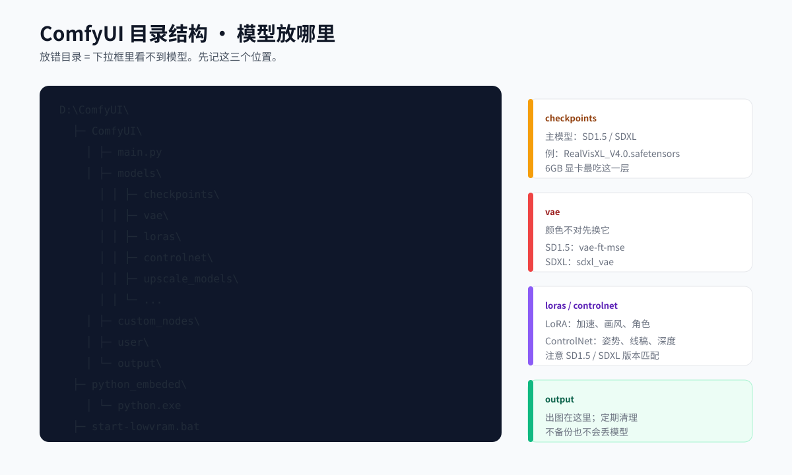

# 02 · 安装 ComfyUI：从下载到第一次启动

> 目标：装好一个**干净**的 ComfyUI 便携版，能打开网页，不装任何插件。
> 预计时间：下载快的话 20 分钟，慢的话 1–2 小时。

---

## 1. 安装前准备

### 1.1 关闭这些东西

- 游戏
- 浏览器里正在播放的视频
- MuMu / 雷电等安卓模拟器
- Wallpaper Engine
- 剪映 / PR / AE
- 其他占用显卡的软件

### 1.2 准备目录

推荐：

```text
D:\ComfyUI\          ← 程序
D:\ComfyUI\_download\ ← 安装包（装完可删）
```

不要用：

```text
C:\Program Files\    ← 权限问题
D:\我的软件\ComfyUI\  ← 中文路径
D:\Comfy UI\         ← 空格
```

### 1.3 检查磁盘

```powershell
Get-PSDrive D | Select-Object Name,@{n='FreeGB';e={[math]::Round($_.Free/1GB,1)}}
```

- 只跑 SD1.5：至少 15GB
- 加 SDXL：至少 40GB
- 加视频：至少 80GB

---

## 2. 一键安装（推荐）

在仓库根目录打开 PowerShell：

```powershell
powershell -ExecutionPolicy Bypass -File .\scripts\install-windows.ps1 -InstallDir "D:\ComfyUI"
```

### 脚本做了什么

```text
检查 64 位系统
  ↓
检查 NVIDIA 驱动
  ↓
检查磁盘空间
  ↓
下载 7zr.exe（约 600KB）
  ↓
下载 ComfyUI_windows_portable_nvidia.7z（约 2GB）
  ↓
解压到 D:\ComfyUI
  ↓
生成 start-lowvram.bat / start-4gb.bat / start-safe-mode.bat
  ↓
跑 verify-install.ps1
```

### 成功的样子

```text
==> 校验安装
  [PASS] ComfyUI\main.py
  [PASS] python_embeded\python.exe
  [PASS] models 目录
  [PASS] start-lowvram.bat
  [PASS] start-4gb.bat
  [PASS] Torch 可导入
  [PASS] CUDA 可用
=== 结果：PASS ===
```

> 如果 `CUDA 可用` 是 FAIL，先别继续。看第 6 节。

---

## 3. 手动安装（脚本失败时）

### 3.1 下载安装包

打开：

<https://github.com/Comfy-Org/ComfyUI/releases>

找最新 release，下载：

```text
ComfyUI_windows_portable_nvidia.7z
```

v0.42.1 直链：

```text
https://github.com/Comfy-Org/ComfyUI/releases/download/v0.42.1/ComfyUI_windows_portable_nvidia.7z
```

文件约 **2GB**。如果只有几 MB，说明下错了。

### 3.2 下载 7-Zip

<https://www.7-zip.org/>

安装 7-Zip，或下载 standalone 的 `7zr.exe`。

### 3.3 解压

右键 `.7z` → 7-Zip → 解压到 `D:\ComfyUI`。

解压后检查：

```text
D:\ComfyUI\
├─ ComfyUI\
│  └─ main.py
├─ python_embeded\
│  └─ python.exe
├─ update\
├─ run_nvidia_gpu.bat
└─ README.md
```

如果多了一层 `ComfyUI_windows_portable`：

```text
D:\ComfyUI\ComfyUI_windows_portable\ComfyUI\main.py
```

把 `ComfyUI_windows_portable` 里面的内容移到 `D:\ComfyUI`。

### 3.4 验证

```powershell
Test-Path "D:\ComfyUI\ComfyUI\main.py"
Test-Path "D:\ComfyUI\python_embeded\python.exe"
```

两个都要 `True`。

---

## 4. 目录结构详解



```text
D:\ComfyUI\
├─ ComfyUI\
│  ├─ main.py               ← 启动入口
│  ├─ models\               ← 模型
│  │  ├─ checkpoints\       ← 主模型
│  │  ├─ vae\               ← VAE
│  │  ├─ loras\             ← LoRA
│  │  ├─ controlnet\        ← ControlNet
│  │  ├─ upscale_models\    ← 放大模型
│  │  └─ ...
│  ├─ custom_nodes\         ← 插件
│  ├─ user\                 ← 你的工作流/设置
│  ├─ output\               ← 出图
│  └─ input\                ← 输入图
├─ python_embeded\          ← 自带 Python
│  └─ python.exe
├─ update\                  ← 升级脚本
├─ start-lowvram.bat        ← 6/8GB 启动
├─ start-4gb.bat            ← 4GB 启动
├─ start-safe-mode.bat      ← 禁用插件启动
└─ run_nvidia_gpu.bat       ← 官方启动
```

**记住三个位置**：

1. 模型放 `ComfyUI\models\`
2. 出图在 `ComfyUI\output\`
3. 工作流在 `ComfyUI\user\default\workflows\`

---

## 5. 第一次启动

### 5.1 双击启动脚本

6GB / 8GB：

```text
D:\ComfyUI\start-lowvram.bat
```

4GB：

```text
D:\ComfyUI\start-4gb.bat
```

### 5.2 看控制台

正常会输出：

```text
Total VRAM 6144 MB, total RAM 16384 MB
...
Starting server
To see the GUI go to: http://127.0.0.1:8188
```

看到最后一行就成功了。

### 5.3 打开浏览器

<http://127.0.0.1:8188>

第一次打开可能白屏几秒，正常。

### 5.4 启动失败长什么样

| 控制台 | 原因 | 处理 |
|---|---|---|
| `Python was not found` | 用了系统 Python | 用 `python_embeded\python.exe` |
| `ModuleNotFoundError` | 依赖缺失 | 重装便携版；不要混用系统 Python |
| `CUDA out of memory` | 启动就 OOM | `--novram`；关其他程序 |
| `Address already in use` | 8188 被占 | 换 `--port 8189` |
| `No module named 'torch'` | 下成了 CPU 包 | 重下 `..._nvidia.7z` |
| 卡在 `IMPORT FAILED` | 插件问题 | `start-safe-mode.bat` |

---

## 6. CUDA 不可用怎么办

### 6.1 先确认

```powershell
D:\ComfyUI\python_embeded\python.exe -c "import torch; print(torch.__version__); print(torch.cuda.is_available())"
```

期望：

```text
2.x.x+cu12x
True
```

### 6.2 如果 False

按顺序：

1. **更新 NVIDIA 驱动**
   - <https://www.nvidia.cn/drivers/lookup/>
   - 选你的显卡型号，下载 Studio Driver 或 Game Ready Driver。
2. **确认下的是 NVIDIA 包**
   - 文件名必须含 `nvidia`，不是 `amd` / `intel` / `cpu`。
3. **笔记本双显卡**
   - NVIDIA 控制面板 → 管理 3D 设置 → 程序设置 → 添加 `python.exe` → 高性能。
4. **不要用系统 Python**
   - 系统 Python 可能装的是 CPU 版 torch。
5. **重启**
   - 装完驱动必须重启。

### 6.3 还是不行

```powershell
nvidia-smi
```

如果这条都失败，说明驱动/硬件层面有问题，先解决它，别折腾 ComfyUI。

---

## 7. 安装后立刻做的 3 件事

### 7.1 建模型目录

```powershell
$m = "D:\ComfyUI\ComfyUI\models"
"checkpoints","vae","loras","controlnet","upscale_models","embeddings","facerestore_models","rembg","inpaint" |
  ForEach-Object { New-Item -ItemType Directory -Force -Path (Join-Path $m $_) | Out-Null }
```

### 7.2 确认端口

```powershell
Invoke-RestMethod "http://127.0.0.1:8188/system_stats"
```

能看到 JSON 就说明服务正常。

### 7.3 备份启动脚本

把 `start-lowvram.bat` 复制一份到桌面，改名为“ComfyUI 低显存”。

---

## 8. 常见安装问题

### Q：解压后没有 `python_embeded`

下载的是源码包，不是便携包。重新下 `ComfyUI_windows_portable_nvidia.7z`。

### Q：双击 bat 一闪而过

在 PowerShell 里手动运行，看报错：

```powershell
cd /d D:\ComfyUI
.\start-lowvram.bat
```

### Q：Windows 提示“已保护你的电脑”

这是 SmartScreen。确认来源是官方 GitHub 后，点“更多信息” → “仍要运行”。

### Q：安装路径能不能放 C 盘

能，但 C 盘通常小，模型很快占满。建议 D/E 盘。

### Q：能不能装在移动硬盘

能，但加载慢，且 USB 断开会崩。只建议存放不常用模型。

### Q：需要装 Git 吗

只跑 ComfyUI 不需要。装插件/更新时可能需要。

### Q：需要装 Python 吗

不需要。便携版自带 Python。

---

## 9. 本章检查清单

- [ ] `ComfyUI\main.py` 存在
- [ ] `python_embeded\python.exe` 存在
- [ ] `torch.cuda.is_available()` 是 True
- [ ] 能打开 <http://127.0.0.1:8188>
- [ ] 有 `start-lowvram.bat`
- [ ] 模型目录已建好
- [ ] 知道出图在 `output`