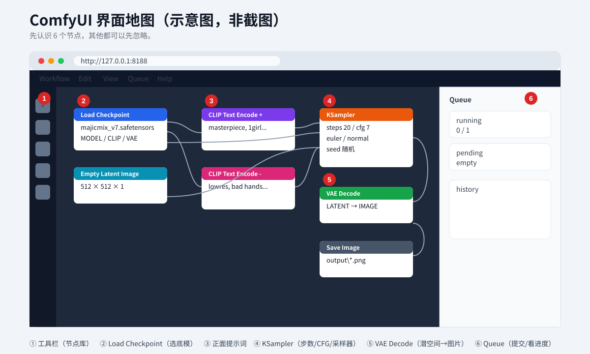

# 05 · 第一张图：界面、节点、参数、保存

> 目标：不改任何代码，拖一个工作流，选模型，点 Queue，出图。

---

## 1. 打开界面

浏览器访问：

```text
http://127.0.0.1:8188
```

第一次打开可能：

- 白屏几秒（前端加载）
- 顶部提示“ComfyUI 有新版本”
- 默认工作流已经铺在画布上



---

## 2. 界面分区

| 区域 | 作用 |
|---|---|
| 顶部菜单 | 工作流、模型库、设置、帮助 |
| 左侧工具栏 | 节点库、搜索、队列 |
| 中间画布 | 节点和连线 |
| 右侧 Queue | 运行队列、历史 |
| 右下角 Queue 按钮 | 提交任务 |

常用快捷键：

| 快捷键 | 作用 |
|---|---|
| `Ctrl + Enter` | 提交 |
| `Ctrl + S` | 保存工作流 |
| `Ctrl + O` | 打开工作流 |
| `R` | 刷新模型/节点列表 |
| 空格 + 拖动 | 平移画布 |
| 滚轮 | 缩放 |
| `Ctrl + A` | 全选 |
| `Delete` | 删除选中节点 |

---

## 3. 认识 6 个核心节点

### 3.1 Load Checkpoint（加载底模）

- 选 `models\checkpoints` 里的 `.safetensors`。
- 输出三个：`MODEL`、`CLIP`、`VAE`。
- 下拉框为空 → 模型没放对 / 没刷新。

### 3.2 CLIP Text Encode（正面提示词）

- 接 `CLIP`。
- 写你想要的。
- 输出 `CONDITIONING` 给 KSampler 的 `positive`。

### 3.3 CLIP Text Encode（负面提示词）

- 接同一个 `CLIP`。
- 写你不想要的。
- 输出给 `negative`。

### 3.4 Empty Latent Image（空画布）

- 设置宽、高、批次。
- 输出 `LATENT` 给 KSampler。
- 低显存：宽高 512/768，batch 1。

### 3.5 KSampler（采样器）

| 参数 | 说明 |
|---|---|
| `seed` | 随机种子，固定可复现 |
| `control_after_generate` | 每次跑完怎么变 seed |
| `steps` | 步数 |
| `cfg` | 提示词强度 |
| `sampler_name` | 采样器 |
| `scheduler` | 调度器 |
| `denoise` | 重绘幅度，文生图用 1.0 |

### 3.6 Save Image（保存）

- 接 `IMAGE`。
- `filename_prefix` 是文件名前缀。
- 出图在 `ComfyUI\output`。

> 还有 `VAE Decode`，把 `LATENT` 变成 `IMAGE`，别漏。

---

## 4. 拖入工作流

1. 下载/找到 `workflows/sd15-basic.json`。
2. 直接把文件拖进浏览器画布。
3. 如果提示“Missing Nodes”，说明工作流用了你没装的插件；这个基础工作流只用原生节点，不应该缺。

### 4.1 检查节点

拖入后应该看到：

```text
CheckpointLoaderSimple
EmptyLatentImage
CLIPTextEncode ×2
KSampler
VAEDecode
SaveImage
```

### 4.2 检查连线

| 从 | 到 |
|---|---|
| Checkpoint.MODEL | KSampler.model |
| Checkpoint.CLIP | 正面 CLIP.clip |
| Checkpoint.CLIP | 负面 CLIP.clip |
| Checkpoint.VAE | VAEDecode.vae |
| 正面.CONDITIONING | KSampler.positive |
| 负面.CONDITIONING | KSampler.negative |
| EmptyLatent.LATENT | KSampler.latent_image |
| KSampler.LATENT | VAEDecode.samples |
| VAEDecode.IMAGE | SaveImage.images |

---

## 5. 选模型

在 `Load Checkpoint` 的下拉框里选：

- 4GB：`majicmixRealistic_v7.safetensors`
- 6GB：同上，或 `RealVisXL_V4.0.safetensors`（记得换 768 工作流）
- 动漫：`MeinaMix_V11.safetensors` / `animagine-xl-4.0-opt.safetensors`

如果下拉框是空的：

1. 确认文件在 `D:\ComfyUI\ComfyUI\models\checkpoints`。
2. 按 `R` 刷新。
3. 还没用 → 重启 ComfyUI。
4. 检查文件是不是 `.safetensors` / `.ckpt`。

---

## 6. 填参数

### 6.1 SD1.5 新手模板

| 参数 | 值 |
|---|---|
| 宽 × 高 | 512 × 512 |
| batch_size | 1 |
| steps | 20 |
| cfg | 7 |
| sampler | euler |
| scheduler | normal |
| denoise | 1.0 |

### 6.2 提示词

正面：

```text
masterpiece, best quality, highly detailed,
1girl, solo, upper body, looking at viewer,
soft lighting, cinematic, depth of field
```

负面：

```text
lowres, bad anatomy, bad hands, text, watermark,
extra fingers, missing fingers, worst quality, jpeg artifacts
```

> 不要堆 100 个词。先 10–20 个，跑通再加。

### 6.3 种子

- `randomize`：每次不同
- `fixed`：固定
- `increment`：每次 +1
- `decrement`：每次 -1

想比较参数时，固定 seed，只改一个变量。

---

## 7. 提交

点右下角 **Queue**，或 `Ctrl + Enter`。

### 7.1 看进度

- 节点边框会高亮。
- 有预览的话会显示采样过程。
- 右侧 Queue 显示 running / pending。

### 7.2 等待时间

| 场景 | 6GB |
|---|---|
| 首次（加载模型） | 10–20 秒 |
| SD1.5 512 / 20 步 | 5–10 秒 |
| SD1.5 768 / 20 步 | 10–20 秒 |
| SDXL 768 / 25 步 | 40–90 秒 |
| SDXL + 放大 | 3–10 分钟 |

### 7.3 成功

- `Save Image` 节点出现图。
- `output` 目录出现 PNG。
- 控制台没有红色报错。

---

## 8. 保存与复用

### 8.1 保存工作流

`Ctrl + S`，或菜单 → Save。

默认在：

```text
D:\ComfyUI\ComfyUI\user\default\workflows\
```

建议命名：

```text
sd15-portrait-512.json
sdxl-768-lowvram.json
```

### 8.2 导出图片

- 右键图片 → Save Image。
- 或直接去 `output` 目录拿。

### 8.3 复现一张图

要固定：

1. 模型
2. 正面/负面提示词
3. 尺寸
4. steps / cfg / sampler / scheduler
5. seed
6. LoRA / ControlNet 及权重

少一个都可能不一样。

---

## 9. 批量出图

### 9.1 一次多张

- `EmptyLatentImage` 的 `batch_size` 改成 2–4。
- 低显存建议 1，或分多次跑。

### 9.2 多个 seed

- KSampler 的 `control_after_generate` 设 `randomize`。
- 连续点 Queue。
- 或用 `batch_size` + 不同 seed。

### 9.3 队列

右侧 Queue 可以：

- 查看 pending
- 取消
- 清空
- 查看历史

---

## 10. 出图后检查

| 检查 | 通过标准 |
|---|---|
| 画面 | 不是全黑/花屏/纯色 |
| 构图 | 主体完整，没有明显双头 |
| 手 | 能看，不崩 |
| 文字 | 没有乱码水印 |
| 文件 | `output` 有 PNG |
| 日志 | 没有 Traceback |

不通过 → 看 `06-troubleshooting.md`。

---

## 11. 从第一张图到“能用”

第一张图只是证明“跑通了”。接下来：

1. 固定一个模型，跑 20 张，熟悉提示词。
2. 固定 seed，调 steps / cfg，看差异。
3. 加一个 LoRA，看画风变化。
4. 加一个 ControlNet，学控图。
5. 加放大，出 2K 图。
6. 再考虑 SDXL / 视频。

**不要第一天就装 30 个插件。**

---

## 12. 本章检查清单

- [ ] 能打开 8188
- [ ] 能拖入 `sd15-basic.json`
- [ ] 能选到模型
- [ ] 能点 Queue
- [ ] 能出图
- [ ] 能在 `output` 找到文件
- [ ] 会保存工作流
- [ ] 会固定 seed 复现